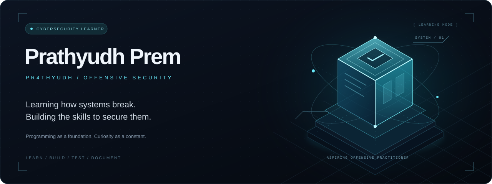

  

  <a href="https://pr4thyudh.github.io/PR4THYUDH/"><strong>ENTER THE INTERACTIVE PROFILE ↗</strong></a> 
  Rotate the 3D core · Explore my learning focus · Try the profile terminal

  <strong>Understand the system. Question the assumptions. Learn how to secure it.</strong>

  <a href="https://github.com/PR4THYUDH?tab=repositories">Explore my repositories</a>
  &nbsp; · &nbsp;
  <a href="https://linkedin.com/in/prathyudh">LinkedIn</a>
  &nbsp; · &nbsp;
  <a href="mailto:prathyudhpremap@gmail.com">Email</a>

---

### 01 / About me

I'm **Prathyudh Prem**, a BCA graduate learning cybersecurity and working toward the **offensive side of security**.

I learned programming to support that goal: to understand how applications work, read the logic behind them, and build tools that help me investigate security questions. My development projects are part of that foundation.

I'm still learning. This profile is a place to share that progress through code, practical experiments, and clear explanations.

### 02 / The direction I'm building toward

<strong>Explore my offensive-security learning focus</strong>

| Focus | What I want to understand and practise |
| :--- | :--- |
| **Web application security** | How requests, authentication, access control, and input handling can go wrong. |
| **Systems & networking** | The operating-system and network fundamentals behind an application's behaviour. |
| **Security scripting** | Using programming to automate repeatable tasks and make sense of results. |
| **Offensive methodology** | Moving from observation to a testable hypothesis, then documenting impact and remediation. |

> My practice belongs in my own environments, purpose-built labs, and systems where I have explicit permission to test.

### 03 / Programming foundation

<strong>Open my programming toolkit</strong>

These are the technologies behind my existing development work:

  
  
  
  
  
  
  

Building applications gives me a useful starting point for understanding their attack surface—from browser interactions and backend routes to database operations.

### 04 / What I aim to share next

- **Lab notes** that explain what I tried, what happened, and what I learned.
- **Small security scripts** with a clear purpose, usage instructions, and limitations.
- **Application security experiments** that connect a weakness with its cause and a possible fix.

---

  PR4THYUDH &nbsp; / &nbsp; LEARN · BUILD · TEST · DOCUMENT

