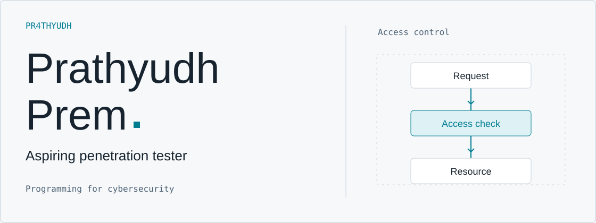

<picture>
  <source media="(max-width: 640px) and (prefers-color-scheme: dark)" srcset="./assets/profile-dark-compact.svg">
  <source media="(max-width: 640px) and (prefers-color-scheme: light)" srcset="./assets/profile-light-compact.svg">
  <source media="(prefers-color-scheme: dark)" srcset="./assets/profile-dark.svg">
  <source media="(prefers-color-scheme: light)" srcset="./assets/profile-light.svg">
  
</picture>

# Prathyudh Prem

**Aspiring penetration tester · MCA student · Cybersecurity learner**

I learned programming for cybersecurity. I build projects to understand how applications work, practise testing their behaviour, and develop the skills I need for penetration testing.

[View my interactive profile](https://pr4thyudh.github.io/PR4THYUDH/) · [LinkedIn](https://linkedin.com/in/prathyudh) · [Email me](mailto:prathyudhpremap@gmail.com)

## Selected projects

### [FinSight — Expense Tracker](https://github.com/PR4THYUDH/Expense-Tracker)

A Django expense app with authentication and user-scoped records. Includes tests for cross-user access to viewing, editing, deleting and exporting expenses.

<code>Python</code> <code>Django</code> <code>Access control</code> · <a href="https://github.com/PR4THYUDH/Expense-Tracker/blob/main/core_app/tests.py">Read the access-control tests</a>

### [Movie Insight Builder](https://github.com/PR4THYUDH/Movie_Insight_Builder)

An Angular and Express movie lookup app integrating the OMDb API. A project for working with browser requests, backend routes and external API responses.

<code>TypeScript</code> <code>Angular</code> <code>Node.js</code> <code>Express</code>

## Cybersecurity learning focus

| Area | What I’m working toward |
| :--- | :--- |
| **Web application testing** | Understanding requests, authentication, access control and input handling. |
| **Systems and networking** | Developing the fundamentals behind application and network behaviour. |
| **Security scripting** | Using programming to automate repeatable tasks and interpret results. |
| **Pentest reporting** | Connecting evidence to impact, explaining the cause and recommending a fix. |

## Education and training

- **Master of Computer Applications (pursuing)** · Sreenarayana Guru Open University
- **OCSP course (in progress)** · Offenso Hackers Academy
- **Bachelor of Computer Applications (completed)**

<strong>Programming toolkit</strong>

Tools used across my projects: Python, Django, JavaScript, TypeScript, Angular, Node.js, Express, HTML, CSS and Git.

I’m developing this programming foundation alongside my cybersecurity training and practical projects.

